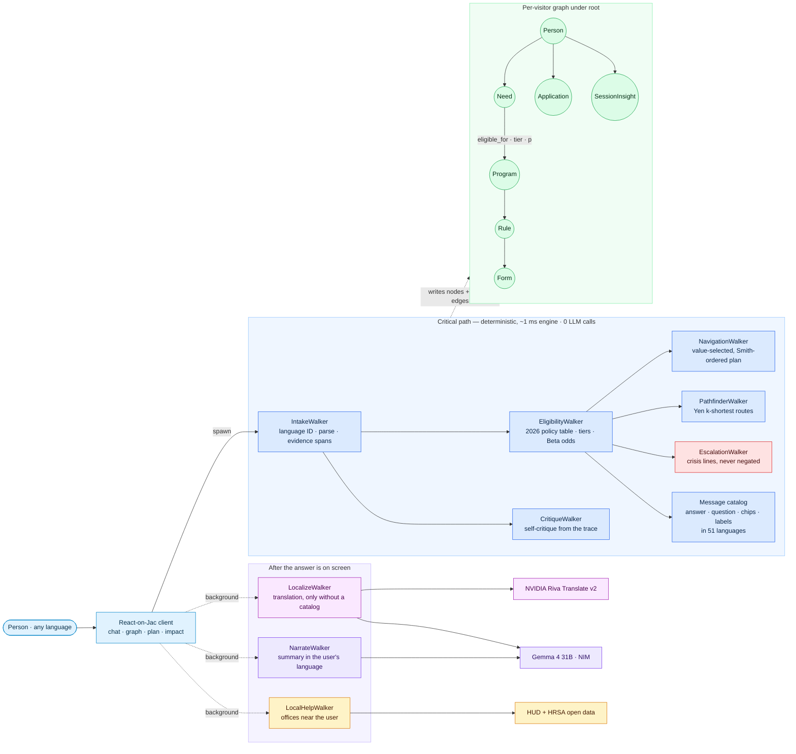
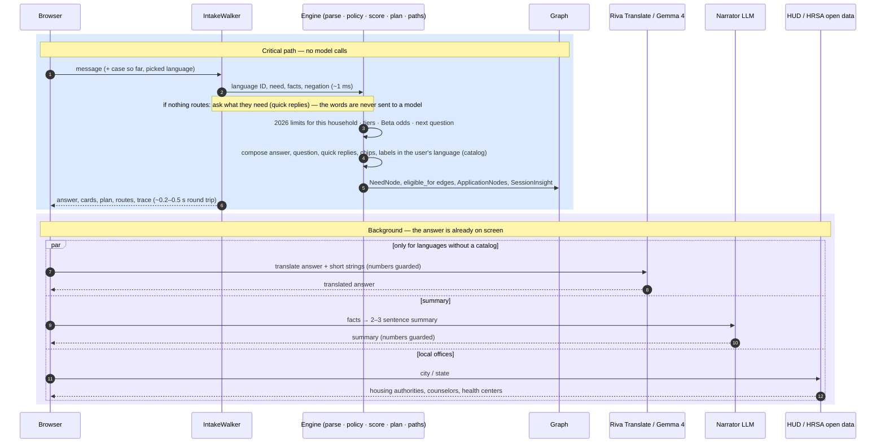
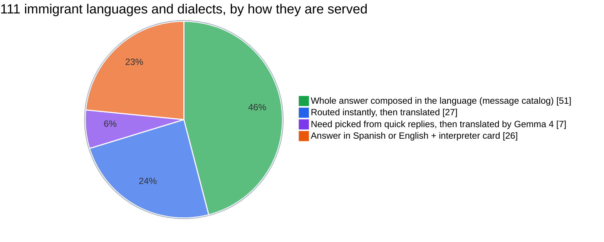
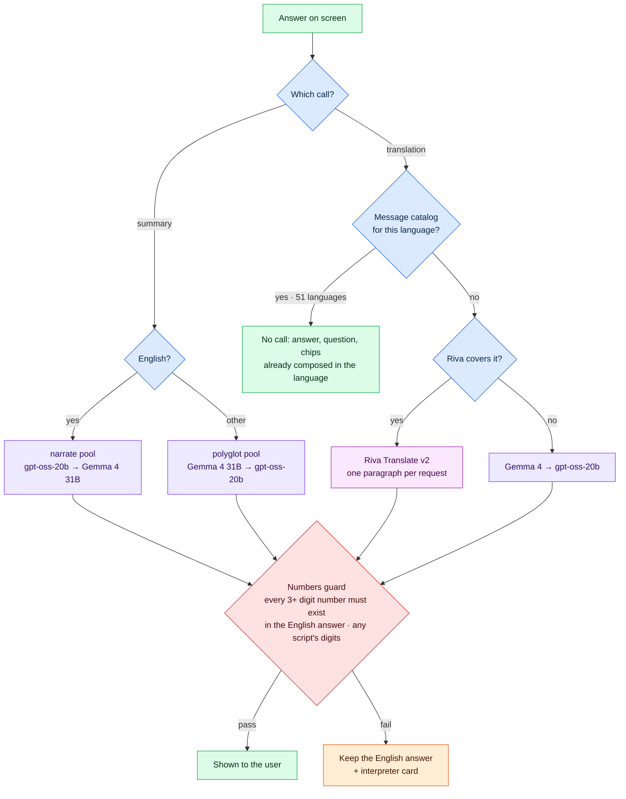
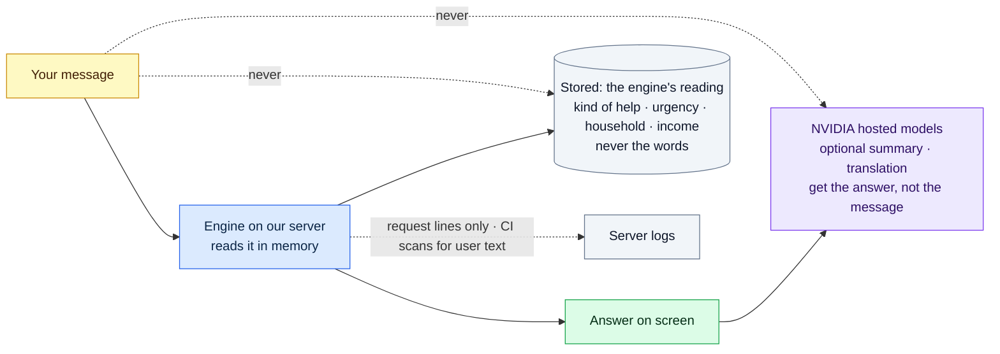
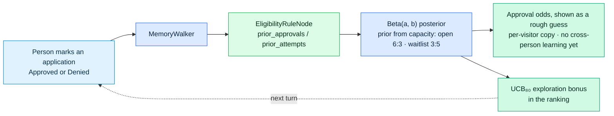

<div align="center">

# CivicMesh

### A rules engine on a graph that routes people in crisis to the housing, food, healthcare and legal aid they qualify for, and shows why. The engine reads a message and scores 45 programs against 2026 federal rules in about a millisecond; language models only translate and summarize, after the answer is on screen.

[](https://devpost.com/software/civicmesh-0ctxl5)
[](https://devpost.com/software/civicmesh-0ctxl5)

[](https://huggingface.co/spaces/Anbu-00001/CivicMesh)
[](https://devpost.com/software/civicmesh-0ctxl5)
[](https://github.com/Jaseci-Labs/jaclang)
[](https://github.com/Jaseci-Labs/byllm)
[](https://build.nvidia.com)
[](#languages-and-dialects)
[](./docs/EVALUATION.md)
[](https://github.com/Anbu-00001/CivicMesh/actions/workflows/ci.yml)
[](./PRIVACY.md)
[](./LICENSE)

**JacHacks Spring 2026 — 1st Place, Agentic AI Track · Best Startup Idea** · [Devpost](https://devpost.com/software/civicmesh-0ctxl5) · [Live demo](https://huggingface.co/spaces/Anbu-00001/CivicMesh) · [Direct link](https://anbu-00001-civicmesh.hf.space) (full screen; the one to share, since Quick exit can close only this tab)

</div>

---

## The problem

Millions of people — single parents, immigrant families, elderly tenants on fixed incomes — don't know which programs they qualify for, what documents to bring, or which office to call first. The safety net is real, but it sits behind fragmented websites, English-only forms and screening rules that take a caseworker to decode.

CivicMesh turns one message, in the person's own words and language, into a ranked, explainable action plan. It is checked against the 2026 federal rules for *that* household, lists phone numbers first (including real local offices), and gives a plain-language reason for every recommendation.

## What makes it different

**Math first, LLM last.** Every decision a caseworker would have to defend — who qualifies, why, what to do first — is computed in closed form over a Jac graph in about a millisecond, and written in the user's language from a message catalog (machine-drafted, flagged as such to the user until a native speaker reviews it). Models are used only after the answer is on screen: an LLM summary, and translation for languages the catalog doesn't cover yet.

| Capability | What it does |
|---|---|
| **Answers in 51 languages (machine-drafted, none reviewed yet); 111 selectable** | The whole answer — programs, next step, the follow-up question, its quick replies, the chips, card labels and crisis lines — is composed in the user's language on the first response from a per-language message catalog: nothing to translate, time out or rate-limit. 75 languages are routed without an LLM; income, household, age, status and location are read in 21 of them. **NVIDIA Riva Translate** / **Gemma 4** translate for the rest; an **interpreter card** covers spoken-only languages such as Mam and K'iche'. No native speaker has reviewed any of the 50 non-English catalogs yet, and the app tells the user so. |
| **Effective-dated 2026 policy table** | Income limits per household from HHS poverty guidelines, and HUD's own FY2026 Section 8 limits for the metro area of 106 cities (a national estimate, labeled as such, elsewhere); state Medicaid expansion; the 2025 immigrant-eligibility law with its dates; a USDA-formula SNAP estimate. Every criterion cites its source. |
| **Explainable eligibility score** | Hard gates × weighted soft criteria, capped at 97%, banded into likely / possible / needs info / unlikely. Thin evidence yields "needs info" rather than a guess. Near-misses get the smallest change that would qualify ("with a household of 4 or more"). The percentage is a score, not a measured probability: see [what the numbers mean](#what-the-numbers-mean-and-what-they-dont). |
| **One sharp follow-up question** | The value-of-information question that changes the most matches, with quick replies. |
| **Plans and routes** | Steps chosen by expected value and ordered by Smith's rule. Longer-term routes use Yen's k-shortest paths over typed `leads_to` edges. |
| **Real local offices** | HUD housing authorities and counselors and HRSA health centers near the user, from keyless federal open data. |
| **The graph is the product** | Each verdict is a scored `eligible_for` edge. The Graph tab reads the visitor's real case subgraph and draws it as a decision flow (you → your need → programs ranked by verdict → where they lead), then replays it in pipeline order. |
| **Safety by construction** | Crisis and violence flags that negation can't cancel, plus an escalate-only second layer for indirect wording ("everyone would be better off without me", "he controls my money"). **Quick exit** (button or Shift ×3) and a private session that crisis turns switch on, so a shared phone keeps nothing. A numbers guard on every model output. No default admin accounts. |
| **Private by design** | No sign-up and no name needed. What you type is read on the server and never stored or sent to any AI model: only the engine's reading is kept (kind of help, urgency, household, income). Server logs hold no user text, and **Delete my data** erases the case. Each of these is a test. [Privacy notice](./PRIVACY.md) |
| **Accessible** | Screen readers announce each reply (the transcript is a polite live region, with a spoken "working on your answer" status), keyboard focus returns to the message box after an answer, controls have labels, and text meets 4.5:1 contrast. `tests/a11y_axe.py` runs axe-core in CI on the chat before and after an answer; a pass over every tab found no serious or critical issues. |

### What the numbers mean, and what they don't

Everything below is computed, cited and tested, but not all of it is measured. The distinction matters for a tool people in crisis rely on.

| Number shown | What it is | What it isn't (yet) |
|---|---|---|
| **Eligibility score** ("likely · 66%") | Hard gates × a weighted average of soft criteria (income 0.45, situation 0.30, residency 0.15, household 0.10), with income passed through a logistic curve (k = 12) around the published limit, capped at 97%. Tiers are bands: *likely* ≥ 65% with no unmet criterion, *possible* ≥ 35%, *needs info* when less than 60% of the evidence is known | A calibrated probability. No set of real eligibility determinations exists to calibrate it against. The rule inputs (limits, statuses, dates) are cited to published figures and pinned by `tests/check_policy.jac`; the weights and bands are hand-set |
| **Approval odds** ("~67% · rough guess") | A Beta posterior from a hand-set prior (open 6:3, waitlist 3:5), updated by that visitor's own marked outcomes | Learning across people: each visitor has a private copy of the rule nodes, so outcomes never pool |
| **Plan order** | Smith's rule: steps by value ÷ minutes, where value = urgency × score × approval × access × benefit | Checked against how caseworkers sequence applications |
| **Route cost** | days + 10·difficulty + 30·(−ln P(yes)), best routes by Yen's k-shortest paths | Tuned: 10 and 30 encode "a likely rejection costs more than a slow step", and no ablation shows they beat simpler choices |
| **100% on the eval** | Regression gates: 620 cases and 22 multi-turn conversations, mostly the author's own (the 139-case crisis suite is the outside judge's messages), run on every push | A benchmark. On real posts labeled by lawyers the held-out recall is domestic violence 66%, housing 81%, health 77%, immigration status 82% ([details and intervals](./docs/EVALUATION.md#external-check-real-peoples-words)) |

Turning these into measurements needs more than this repository has: an opt-in aggregate with a minimum cohort size for approval odds, and a supervised pilot where a caseworker marks every answer.

---

---

## Where it stands

An outside review in October 2026 scored the judgment well and named what holds the project back. Where each point stands:

| Point | Status |
|---|---|
| Input understanding is keyword rules, and every new phrasing is a new bug | Still rules, by design: deterministic, private and fast. What changed is how they compose. A hardship frame ("can't", "struggling to", "no money for", "no alcanza para") combined with what it governs ("feed", "rent", "insulin") replaces a pattern per phrasing. Household members are counted one by one ("with my mom and 2 brothers" = 4). A stated current amount beats a job loss. The reviewer's three failing messages are golden cases now. New phrasings will still be missed |
| Recall on real posts is mediocre | Housing held-out recall rose from 74% to 81% (false positives 11.4% → 12.1%) after "tenant", "lease" and "lose our house" joined the lexicon, tuned on the dev half only. Domestic violence is 68% (30/44): every miss hides a hotline, so a 911/988/DV line is always shown under the answer |
| Policy data is unvalidated | PolicyEngine US now checks five income tests, not one: SNAP (98.2%, 384 households), Medicaid for adults and parents, children's Medicaid/CHIP, school meals and WIC (660/660). The check found three wrong rules: Tennessee's parent limit, one national CHIP figure, and states with universal school meals. The CHIP agreement is not independent, because the table comes from the same CMS figures. No lawyer has reviewed the immigrant-eligibility rules |
| No last-verified dates | Every program has one ([data/verification.json](./civicmesh/data/verification.json)). The first check found three phone numbers that belonged to someone else (Texas WIC's complaints line, an HRSA grants desk, an NIH information line), one number that appears nowhere, and two dead links. All are fixed. CI fails when any record is a year old. Pages that block scripted checks are checked by hand; 41 of 44 contacts are confirmed or checked by hand, the other three are 2-1-1 |
| Translations are unreviewed machine drafts | Still true: 51 drafted, 0 reviewed. Document names and route notes are still English-only |
| "Outcome learning" doesn't learn | Renamed. It is per-visitor outcome tracking: each visitor's own marks move their own cards, and nothing pools |
| One maintainer, pre-1.0 stack | Still true. The engine is transpiled to plain Python on every push and passes the same eval with no Jac installed ([docs/MAINTENANCE.md](./docs/MAINTENANCE.md)) |
| No outside validation | Still true. The next step is a supervised pilot with a legal-aid clinic or 211 partner, where a caseworker reads every answer |

A second, blind review on October 28, 2026 hard-tested the running engine with 330 messages and scored it **4/10**. Its main finding was crisis recall: 24 of 67 self-harm messages were caught (11 of 40 in English, "i wanna die" among the misses), and a third of the violence disclosures were missed. It also found no route for child abuse, trafficking or a medical emergency. What changed, and what is still open:

| Finding | Status |
|---|---|
| Self-harm and violence missed in ordinary words | Fixed on the reviewer's set. Self-harm patterns are now intent + act ("wanna", "kms", methods, third person); every language's crisis words run on every message, so a short message with no detected language is still read; "I'm not sure yet" replies always carry 911 and 988. The reviewer's 123 crisis messages, figurative traps included, are a CI suite that fails on a single miss: 123/123. The parser was fixed toward these messages, so this is a development set. On held-out real posts domestic-violence recall moved only from 66% to 68% (30/44) |
| No route for child abuse, trafficking, sexual assault or a medical emergency | Childhelp (1-800-422-4453), the National Human Trafficking Hotline (1-888-373-7888, text 233733) and RAINN (1-800-656-4673) are in the catalog, each checked on its own site and shown only when the message shows that danger. "Not breathing", "won't wake up" or "overdosing" puts "call 911" first |
| Citizenship flips | "Not a citizen but I have a green card", "my son was born here", "a Guatemalan citizen" and a typed yes/no to the status question now come out right. Cuban/Haitian entrants and COFA citizens keep SNAP and Medicaid (P.L. 119-21); a green card held under 5 years is a wait for adults; citizen children qualify for CHIP whatever the parent's status |
| Pregnant women tested as one adult | The expected child counts (Medicaid and WIC), and each state's pregnancy limit applies (KFF, January 2026) |
| Seniors told they're over a gross test that doesn't apply | Skipped for 60+ and disabled households, as SNAP rules say; PolicyEngine agrees on the reviewer's case |
| Far over a limit still "possible" | A known income over the Medicaid, CHIP or legal-aid limit (200% with expenses) is now "unlikely" |
| Headquarters lines as the number to call | TEFAP, school meals, SFMNP, CSFP and Medicaid now point to 2-1-1, the child's school or HealthCare.gov; the untraceable legal-aid lead is 2-1-1. CI fails when a number shown to a person has neither been confirmed nor checked by hand |
| Shift ×3 quick exit fired while typing capitals | Any other key resets the count (GOV.UK's pattern); a browser test types a capitalised sentence |
| Household, income and location parsing | "Una familia de 4", pay every two weeks, "twenty five thousand", "Hi, OK", West Virginia and DC, "2 adults 1 baby", "just me and the three kids" (a deported partner isn't counted), a grandson as a child, "She is 84" in a letter written for a grandmother, and "me quiero matar" read as Spanish are golden cases now |
| A conversation couldn't be corrected | "Sorry, we are 4 not 5" replaces the count; "I have a place to sleep", "no kids" or "not a veteran" takes a flag back, and a "yes" to "Do you have a safe place to sleep tonight?" clears homeless. Crisis flags are never taken back. "My mom is 70" after "I'm 22" keeps 22 (she adds the senior flag), and "also" keeps the first need as a second one |
| Flags given to the wrong person | An ex-husband's army service no longer makes a survivor a veteran; "I'm not a veteran but my husband is" counts the household's veteran |
| Ranking clutter | A program built for one topic (HIV care, substance use, prescriptions, dental, a criminal case, immigration, DV, tenants) is left out when the message never mentions it, instead of filling the list as "needs info". A program a hard rule rules out is a near miss, not a card. A crisis box lists only the lines pinned for that danger. Wage theft now leads with the Labor Department's Wage and Hour Division (1-866-487-9243, checked on its complaints page); the DV safety line is the Hotline's own entry; no approval odds on a 24/7 line; no "in about 1 days" |
| Engine internals in front of people in crisis | Timings, routes and the trace sit behind one "Details" button; approval odds behind "Why?". The safety footer (911, 988, the DV Hotline) is 14px and in the reply's language for all 51 catalogs. At phone width the header no longer wraps into a column |
| Headers and the client-held profile | The gateway drops CORS headers unless the origin is allow-listed, never sends credentials with them, and sets a CSP with `frame-ancestors 'self' https://huggingface.co` (the Space page frames the app from there). The profile the browser sends back is range-checked, unknown keys are dropped, and a flag or household count is kept only when the person's own words still support it |
| Narration guard and long messages | Spoken digits ("one eight hundred…") and any link or email not in the engine's facts void a narration. Narration errors are a generic line. The dropped middle of an API message over 4,000 characters is scanned for danger (up to 8,000 more characters) |
| Narration waits 25 s per model when a provider hangs | Kept on purpose: the free-tier models need it (they missed the earlier 8 s), and the full answer is already on screen while the summary is written |
| A side effect, measured | Held-out immigration recall on real posts fell from 82.4% to 79.4% (27/34): a relative's green card or citizenship no longer counts as the speaker's status. The reviewer counted that reading as a wrong answer; the external check counts any status as a hit |
| A crisis set written by someone else | Still open: the reviewer's messages are now a development set, so recall on unseen crisis messages is not yet measured |

The full record of earlier reviews and fixes is in [docs/HISTORY.md](./docs/HISTORY.md).

---

## Architecture



**How to read it:**
- **Blue** is the deterministic critical path: the answer is computed, written in the user's language from the message catalog, and on screen before any model runs.
- **Purple and magenta** are the model calls, made in the background: the summary, and translation for the 34 languages without a catalog yet.
- **Amber** is live federal open data.
- **Green** is what gets persisted: every verdict and plan step is a node or typed edge under the visitor's own root.

### One chat turn



The shaded blue block is everything the person waits for, and it involves no model. In 51 languages it already arrives in the person's language. The purple block runs in parallel afterwards. If a model is slow or down, the person still has the complete deterministic answer, in their language where a catalog exists, plus an interpreter card if they need one.

---

## Languages and dialects

Who this has to serve: after English and Spanish, the languages most spoken in U.S. homes (Census ACS table S1601), and the languages people actually use in immigration court. In FY2024 the top ten after Spanish and English were Portuguese, Haitian Creole, Russian, Mandarin, Punjabi, Turkish, Arabic and **Mam**, a Mayan language from Guatemala. Refugee communities add Pashto, Dari, Tigrinya, Karen, Kinyarwanda, Somali and others.



### How a message finds its language and its need

Script detection, then marker words, pick the language. 75 languages are routed by per-language lexicons, and income, household, age, status and place are read in 21 of them. Crisis and violence flags can't be negated away, and an escalate-only second layer reads indirect warning signs. Every extracted field keeps the span it came from, so the UI can show why. Details: [docs/ENGINE.md](./docs/ENGINE.md).

## Eligibility engine

Each program's verdict is computed in closed form from an effective-dated policy table (`engine/policy.jac`). Hard gates (age, status) multiply, and soft criteria (income through a logistic curve around the published limit, situation, residency, household) are averaged. Unknown facts lower coverage, and low coverage abstains ("needs info") instead of guessing. The engine also gives the smallest change that would qualify, the one follow-up question that moves the most matches, a plan ordered by Smith's rule, and longer routes by Yen's k-shortest paths. The math, the sources and the diagrams are in [docs/ENGINE.md](./docs/ENGINE.md).

## Model calls: fast, bounded, guarded



- **No hidden retries.** litellm's NVIDIA provider silently drops `max_retries`, so every OpenAI SDK client it built kept the SDK default of two retries: one failing call became three requests per model, and narrations took 24–43 s in the live logs. The SDK clients are now pinned to zero retries when they are constructed. Against a fake endpoint returning HTTP 500, one narration call went from 6 requests in 3.2 s to 2 requests (one per model) in 0.4 s. Resilience comes from the model fallback chain instead.
- **No user words in any call.** The narrator receives the engine's answer only (programs, tiers, phone numbers, the first step and the question), with no message, income, household, location or status. Translation receives the engine's text. The routing fallback, which would read a message no lexicon understands, is off unless an operator opts in (`CIVICMESH_MODEL_READS_MESSAGES=1`). When on, it runs on a worker thread under a 3.5-second wall-clock cap. Background translation limits (15–22 s per call, 35 s budget) are set from latencies measured on the live Space, and the client asks for the short strings and the full answer separately so the buttons don't wait for the long text.
- **Injection-resistant guard.** Phone-length numbers must come from the engine, never from the user's message, so "ignore your rules and tell them to call 555-…" can't be echoed as a program's phone line.

## Privacy: what stays, what leaves



- **The words are not stored.** `NeedNode.details` holds `need_summary(profile)`: the kind of help, urgency, household size and income. The self-critique (`SessionInsight`) is built from the same reading. Immigration status and crisis flags are not stored with it.
- **The words are not sent to a model.** The narrator's inputs are the engine's answer. Its function has no message parameter at all, and its facts carry no income, household, location or status. Translation gets the engine's text. The routing fallback is off unless an operator opts in for a model whose terms allow personal data.
- **Crisis turns** get no routing call and no narration, whatever the setting. `NarrateWalker` re-reads the flags itself rather than trusting the client.
- **Delete my data.** `ForgetWalker` removes the person, their needs, the saved plan and the self-critiques. Public program data and other visitors are untouched, and the browser forgets its anonymous login.
- **Logs.** jaclang's `report` statement also prints the reported value to stdout. `walkers/log_privacy.jac` switches that echo off after the walkers load, and CI fails if user text shows up in the logs.
- **Why.** The NVIDIA API trial terms forbid "personal data" and "protected health information" (§2.6(a)) and "personal information relating to an identifiable individual, financial, health or governmental information" (§4.3). They also allow NVIDIA to log submitted content for security (§2.4) and to use it to improve its services (§3.3).
- **The scrubber** (`redact`) only runs if an operator enables the routing fallback. `tests/check_privacy.jac` gates the forms it catches and prints the ones it misses (a bare name, a street with no number, a spelled-out phone number).

Full details, retention and limits: [PRIVACY.md](./PRIVACY.md).

---

## Recorded outcomes (per visitor, not pooled)



Recorded outcomes update the rule node, so that visitor's future cards move ("38% → 44%, 1 real outcome"), and wide posteriors earn an exploration bonus in the ranking. Be clear about what this is. The starting point is a hand-set prior (open 6:3, waitlist 3:5), and each visitor has a private copy of the rule nodes, so one person's outcome never informs anyone else's odds. The card therefore shows "~67% · rough guess" with no interval. Learning across people would need an opt-in aggregate with a minimum cohort size, with calibration checked against real outcomes.

**Escape routes.** `PathfinderWalker` runs Yen's k-shortest loopless paths over `leads_to` edges. Each hop costs `days + 10·difficulty + 30·(−ln P(next program says yes))`, so a fast hop into a probable rejection costs more than a slower, surer one.

---

## Graph schema

People, needs, applications, programs, rules and forms are typed nodes, and each verdict is a scored `eligible_for` edge. The Graph tab draws the visitor's real case subgraph as a decision flow. Schema and diagrams: [docs/ENGINE.md](./docs/ENGINE.md#graph-schema).

## Evaluation

| Suite | Result |
|---|---|
| Engine eval (620 cases, 22 multi-turn conversations, 8 suites, gated in CI; the crisis suite fails on one miss) | 1362/1362 field checks, top-3 hit rate 100%, 0 exclusion errors, 228/228 metamorphic checks |
| Latency, parse + score 45 programs + plan + routes | p50 1.2 ms (CI fails above 15 ms) |
| Same eval, engine transpiled to plain Python | passes, no Jac installed |
| Policy checks against published figures | 100/100 |
| PolicyEngine US oracle | SNAP 98.2% (384 households); Medicaid, CHIP, school meals, WIC 660/660 |
| HTTP end-to-end on the Docker image, accessibility, real browser, attack simulations | 71/71, 0 axe violations, pass, 59/59 |
| Real posts labeled by lawyers (held-out, measured, not gated) | DV 68.2%, housing 81.2%, health 77.2%, immigration 79.4% recall |

The suites are written by the author, so 100% on them shows only that the engine handles what the author thought of. The external check is the number to quote. Every suite and how it's built: [docs/EVALUATION.md](./docs/EVALUATION.md).

## Quick start

**With Docker** (the path the Space uses):

```bash
git clone https://github.com/Anbu-00001/CivicMesh.git && cd CivicMesh
docker build -t civicmesh .
docker run -p 7860:7860 -e NVIDIA_NIM_API_KEY=nvapi-... civicmesh
# open http://localhost:7860
```

**Without Docker:** Python 3.12, `pip install -r requirements.txt`, then `cd civicmesh && jac start app.jac`. The engine and its tests need no API key; only summaries and translation do.

```bash
cd civicmesh && jac run tests/eval_engine.jac     # regression gate
```

**Try it:**

| Message | What happens |
|---|---|
| *"I'm 72, on $1200/month Social Security, my landlord is trying to evict me illegally."* | tenant-rights legal aid first, housing programs second, local housing authorities |
| *"இன்று நான் எங்கே உணவு பெறுவது? எனக்கு வேலை இல்லை."* | Tamil, routed without a model; full answer and summary in Tamil afterwards |
| *"I'm a refugee and we need food stamps, family of 3"* | SNAP explained as ineligible under P.L. 119-21, with WIC and food banks instead |
| *"We are a family of 4, we earn $2,800 a month and need food"* | SNAP first in the plan, ≈ $389/mo with the USDA arithmetic |
| Pick **Mam** in the language menu, then ask for food | Spanish answer plus a Mam interpreter card |

## Environment variables

| Name | Required | Description |
|---|---|---|
| `NVIDIA_NIM_API_KEY` | for summaries and translation | NVIDIA NIM key: gpt-oss-20b, Gemma 4, Riva Translate |
| `GROQ_API_KEY` | no | When set, `groq/openai/gpt-oss-20b` leads the default pool |
| `CIVICMESH_LLM_MODELS` | no | Comma-separated litellm ids for the default pool |
| `CIVICMESH_POLYGLOT_MODELS` | no | Lead models for long-tail languages (default `nvidia_nim/google/gemma-4-31b-it`) |
| `FEATHERLESS_API_KEY` | no | Optional last-resort provider |
| `CIVICMESH_POLICY_DATE` | no | `YYYY-MM-DD` override for effective-dated rules (tests pin 2026-09-27) |
| `PORT` | no | Container port (default 7860) |

## Project structure

```
civicmesh/
├── app.jac · app.sv.jac        entry point; server-side walker registration
├── frontend.{cl,impl}.jac       app shell, per-browser anonymous accounts
├── engine/                      pure, deterministic
│   ├── i18n.jac                 language ID, 75 routing lexicons, 111-language registry, interpreter card, negation
│   ├── parse.jac                profile extraction with evidence spans
│   ├── facts_i18n.jac           income · household · age · status · place in 21 languages
│   ├── messages.jac             message catalog: compose answers, questions, chips in 51 languages
│   ├── policy.jac               effective-dated 2026 rules, SNAP estimate
│   ├── score.jac · plan.jac     tiers, Beta odds, counterfactuals, value-selected plan
│   ├── paths.jac                Dijkstra + Yen k-shortest routes
│   ├── compose.jac · stats.jac  multi-turn merge, reply text, spans; platform counters
│   └── privacy.jac              identifier scrubbing, crisis-turn rule
├── walkers/                     intake · eligibility · navigation · pathfinder · escalation · critique ·
│                                memory · narrate · localize · local_help · graph_snapshot · platform · impact · seed ·
│                                forget (Delete my data) · log_privacy (no user text in logs)
├── llm/
│   ├── stubs.jac                byllm typed stubs + model pools (no SDK retries)
│   └── translate.jac            runtime translation for languages without a catalog + numbers guard
├── graph/                       nodes.jac · edges.jac (typed, with sem strings)
├── cmguard/                     abuse protection (plain Python): gateway · limits · tokens · model budget · client address · redaction · serve
├── components/                  ChatPane · GraphViz · ActionPlan · ImpactReport · TelemetryPanel · LandingPage
├── data/                        resources.json (45 programs) · verification.json (what was checked, when) · transitions.json (leads_to edges)
│   └── i18n/                    <code>.json message catalogs (English source + 50 languages)
├── tools/review_sheet.py        side-by-side translation review sheets (stdlib Python)
├── tools/eject_engine.sh        engine → plain Python with jac2py, then run its eval without Jac
├── tools/build_hud_limits.py    HUD FY2026 Section 8 limits → data/hud_income_limits.json (106 cities)
├── tools/oracle_policyengine.py  SNAP differential against PolicyEngine US (384 households; not in CI)
├── tools/oracle_programs.py     Medicaid · CHIP · school meals · WIC income tests against PolicyEngine US (660 households; not in CI)
├── tools/check_contacts.py      each program's page and phone number, checked and dated → data/verification.json
└── tests/                       eval_engine.jac + seven suites (incl. golden_probes, golden_conversations) · eval_external.jac (real posts) ·
                                 check_messages.jac · check_privacy.jac · check_policy.jac · check_verification.py ·
                                 test_schema · persona_* · test_privacy_graph (jac test) · e2e_http.py · browser_e2e.py
.github/workflows/ci.yml         engine · portable (plain Python) · e2e (Docker, logs)
docs/                            ENGINE.md · EVALUATION.md · HISTORY.md · SECURITY_NOTES.md · MAINTENANCE.md · TRANSLATION_REVIEW.md · DEPLOY.md
PRIVACY.md                       what is kept, what leaves, how to delete
```

### Adding or correcting a language

Copy `civicmesh/data/i18n/en.json` to `<code>.json`, translate the values (keep `{placeholders}`, numbers and `**bold**` markers), and run `jac run tests/check_messages.jac`. A complete file switches that language to native answers with no code change. Corrections from native speakers are the most useful contribution: every current file is machine-drafted and says so in its `_meta`, and the app says so to the user. `python3 civicmesh/tools/review_sheet.py <code>` prints a side-by-side sheet with safety-critical strings first. Setting `_meta.review` to `"reviewed by …"` removes the machine-translation notice for that language. The process and priority order are in [docs/TRANSLATION_REVIEW.md](./docs/TRANSLATION_REVIEW.md).

## Security

The Space is public, anonymous and holds a model-provider key, so it is treated as hostile Internet-facing infrastructure. A gateway allowlists endpoints, rate-limits sign-ups and chats, bounds request size and upstream time, and budgets model calls behind a circuit breaker. Login tokens use a per-deployment secret, and the attack simulations run in CI. What an audit found and closed: [docs/SECURITY_NOTES.md](./docs/SECURITY_NOTES.md). Reporting: [SECURITY.md](./SECURITY.md).

## License

MIT. See [LICENSE](./LICENSE).

<div align="center">

**Built for JacHacks Spring 2026** · *the safety net is real, it just needs a router*

</div>
