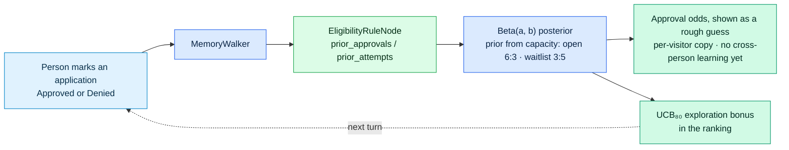

# CivicMesh architecture details

Moved from the README: how the code is laid out and what the graph stores. The README keeps the overview diagram.

## Project structure

```
civicmesh/
├── app.jac · app.sv.jac        entry point; server-side walker registration
├── frontend.{cl,impl}.jac       app shell, per-browser anonymous accounts
├── engine/                      pure, deterministic
│   ├── i18n.jac                 language ID, 75 routing lexicons, 111-language registry, interpreter card, negation
│   ├── parse.jac                profile extraction with evidence spans
│   ├── facts_i18n.jac           income · household · age · status · place in 21 languages
│   ├── messages.jac             message catalog: compose answers, questions, chips in 51 languages
│   ├── policy.jac               effective-dated 2026 rules, SNAP estimate
│   ├── score.jac · plan.jac     tiers, Beta odds, counterfactuals, value-selected plan
│   ├── paths.jac                Dijkstra + Yen k-shortest routes
│   ├── compose.jac · stats.jac  multi-turn merge, reply text, spans; platform counters
│   └── privacy.jac              identifier scrubbing, crisis-turn rule
├── walkers/                     intake · eligibility · navigation · pathfinder · escalation · critique ·
│                                memory · narrate · localize · local_help · graph_snapshot · platform · impact · seed ·
│                                forget (Delete my data) · log_privacy (no user text in logs)
├── llm/
│   ├── stubs.jac                byllm typed stubs + model pools (no SDK retries)
│   └── translate.jac            runtime translation for languages without a catalog + numbers guard
├── graph/                       nodes.jac · edges.jac (typed, with sem strings)
├── cmguard/                     abuse protection (plain Python): gateway · limits · tokens · model budget · client address · redaction · serve
├── components/                  ChatPane · GraphViz · ActionPlan · ImpactReport · TelemetryPanel · LandingPage
├── data/                        resources.json (74 services) · verification.json (what was checked, when) · transitions.json (leads_to edges)
│   └── i18n/                    <code>.json message catalogs (English source + 50 languages)
├── tools/review_sheet.py        side-by-side translation review sheets (stdlib Python)
├── tools/eject_engine.sh        engine → plain Python with jac2py, then run its eval without Jac
├── tools/build_hud_limits.py    HUD FY2026 Section 8 limits → data/hud_income_limits.json (106 cities)
├── tools/oracle_policyengine.py  SNAP differential against PolicyEngine US (384 households; not in CI)
├── tools/oracle_programs.py     Medicaid · CHIP · school meals · WIC income tests against PolicyEngine US (660 households; not in CI)
├── tools/check_contacts.py      each program's page and phone number, checked and dated → data/verification.json
└── tests/                       eval_engine.jac + seven suites (incl. golden_probes, golden_conversations) · eval_external.jac (real posts) ·
                                 check_messages.jac · check_privacy.jac · check_policy.jac · check_verification.py ·
                                 test_schema · persona_* · test_privacy_graph (jac test) · e2e_http.py · browser_e2e.py
.github/workflows/ci.yml         engine · portable (plain Python) · e2e (Docker, logs)
docs/                            ENGINE.md · EVALUATION.md · HISTORY.md · SECURITY_NOTES.md · MAINTENANCE.md · TRANSLATION_REVIEW.md · DEPLOY.md
PRIVACY.md                       what is kept, what leaves, how to delete
```

### Adding or correcting a language

Copy `civicmesh/data/i18n/en.json` to `<code>.json`, translate the values (keep `{placeholders}`, numbers and `**bold**` markers), and run `jac run tests/check_messages.jac`. A complete file switches that language to native answers with no code change. Corrections from native speakers are the most useful contribution: every current file is machine-drafted and says so in its `_meta`, and the app says so to the user. `python3 civicmesh/tools/review_sheet.py <code>` prints a side-by-side sheet with safety-critical strings first. Setting `_meta.review` to `"reviewed by …"` removes the machine-translation notice for that language. The process and priority order are in [docs/TRANSLATION_REVIEW.md](./docs/TRANSLATION_REVIEW.md).

## Graph schema

People, needs, applications, programs, rules and forms are typed nodes, and each verdict is a scored `eligible_for` edge. The Graph tab draws the visitor's real case subgraph as a decision flow. Schema and diagrams: [docs/ENGINE.md](./docs/ENGINE.md#graph-schema).

## Recorded outcomes (per visitor, not pooled)



Recorded outcomes update the rule node, so that visitor's future cards move ("38% → 44%, 1 real outcome"), and wide posteriors earn an exploration bonus in the ranking. Be clear about what this is. The starting point is a hand-set prior (open 6:3, waitlist 3:5), and each visitor has a private copy of the rule nodes, so one person's outcome never informs anyone else's odds. The card therefore shows "~67% · rough guess" with no interval. Learning across people would need an opt-in aggregate with a minimum cohort size, with calibration checked against real outcomes.

**Escape routes.** `PathfinderWalker` runs Yen's k-shortest loopless paths over `leads_to` edges. Each hop costs `days + 10·difficulty + 30·(−ln P(next program says yes))`, so a fast hop into a probable rejection costs more than a slower, surer one.

---

