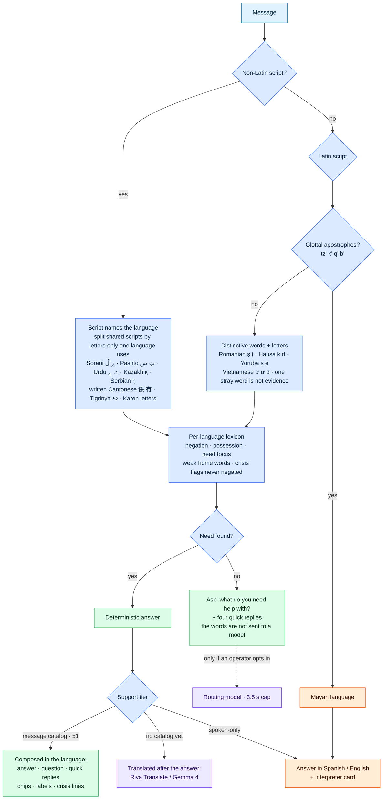
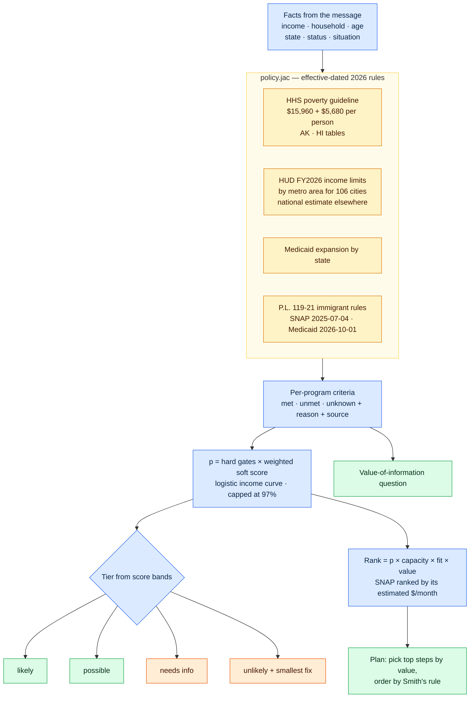
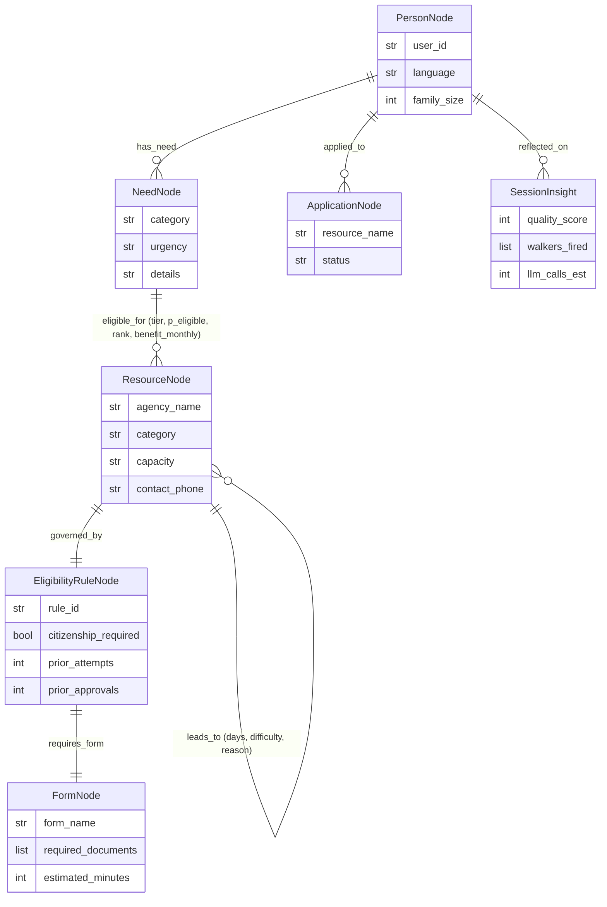
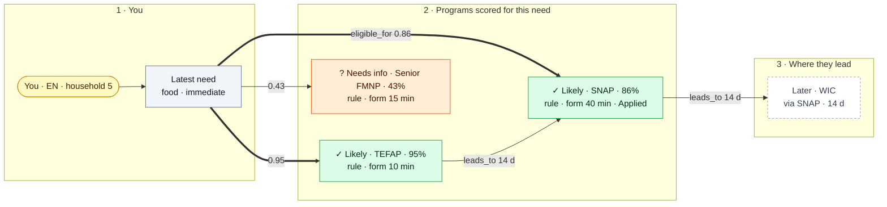

# How the engine works

The parser, the eligibility engine and the graph, in detail. The README has the summary.

## How a message finds its language and its need

| Tier | Languages | What happens |
|---|---|---|
| **Native** | **51** with a message catalog: English, Spanish, Chinese (Simplified), Cantonese (Traditional), Vietnamese, Korean, Tagalog, Russian, Ukrainian, Arabic, Persian, Haitian Creole, Portuguese, French, Polish, Hindi, Urdu, Bengali, Punjabi, Gujarati, Telugu, Tamil, Malayalam, Nepali, Japanese, Khmer, Hmong, Somali, Amharic, Tigrinya, Burmese, Thai, Lao, German, Italian, Greek, Armenian, Romanian, Turkish, Indonesian, Swahili, Pashto, Bosnian/Croatian/Serbian, Dutch, Czech, Slovak, Hungarian, Bulgarian, Lithuanian, Latvian, Albanian | The first response is entirely in the language: the answer, plan steps, follow-up question, quick replies, chips, card labels and crisis lines |
| **Instant** | **75**: English, Spanish, Chinese (Mandarin and written Cantonese), Tagalog, Cebuano, Ilocano, Vietnamese, Arabic, French, Haitian Creole, Korean, Russian, Ukrainian, Portuguese, Cape Verdean Creole, German, Italian, Polish, Hindi, Urdu, Punjabi, Bengali, Gujarati, Telugu, Tamil, Malayalam, Kannada, Marathi, Nepali, Persian (Farsi/Dari), Pashto, Kurdish (Sorani and Kurmanji), Turkish, Hebrew, Yiddish, Greek, Armenian, Georgian, Romanian, Albanian, Bosnian/Croatian/Serbian (both scripts), Bulgarian, Czech, Slovak, Hungarian, Dutch, Kazakh, Uzbek, Mongolian, Japanese, Thai, Lao, Khmer, Burmese, Hmong, Indonesian, Amharic, Tigrinya, Oromo, Somali, Swahili, Kinyarwanda/Kirundi, Lingala, Yoruba, Igbo, Hausa, Twi, Wolof, Fula, Samoan, Tongan, Jamaican Patois, Quechua; plus romanized Hindi and Tamil | Language and need identified in about 1 ms, with the user's own words highlighted |
| **Translated** | Routed languages without a catalog yet (Cebuano, Ilocano, Kurdish, Hebrew, Yiddish, Georgian, Kazakh, Uzbek, Oromo, Kinyarwanda, Yoruba, Igbo, Hausa, …) and the rest of the 111 | The answer arrives in English at once; the short strings, then the full answer, are translated by **Gemma 4 31B** (Riva Translate where it covers the language) — with an honest "didn't arrive in time" note and a retry button if the free endpoint is slow |
| **Interpreter card** | **26** mostly spoken languages without reliable machine translation today: Mam, K'iche', Q'anjob'al, Q'eqchi', Kaqchikel, Akateko, Chuj, Ixil, Mixtec, Zapotec, Triqui, Nahuatl, Purépecha, Tseltal/Tsotsil, Garifuna, Quechua, Dinka, Nuer, Chuukese, Marshallese, Chamorro, Chin, Kachin, Bambara, Ewe, and "Mayan language (unspecified)" | The answer comes in the language most speakers also use (Spanish for Mesoamerican languages), plus a card to show staff: *"I speak Mam. Please get me a free Mam interpreter."* |

A picker in the chat header lists all 111 languages by their own names, for when detection guesses wrong or the language is spoken rather than written.

**Why a catalog instead of translating at runtime.** The first version translated the question, the chips and the full answer with Riva and Gemma after the answer appeared. On the live Space (NVIDIA NIM free tier: 40 requests a minute, shared GPUs) four parallel Riva calls all timed out at 9 s, the full-answer Gemma call timed out, and the follow-up strings arrived 18 s after the answer, so for that long a Chinese speaker saw English buttons. Everything the engine says is a template filled with facts, so the templates are translated once and composed at request time, the way software localization is normally done. This also follows federal guidance to have vital machine-translated content reviewed by people: the catalog is data a native speaker can read and correct.

- **One file per language** (`data/i18n/<code>.json`, 89 keys: 13 questions, 16 quick replies, 16 chips, 9 answer sentences, 10 plan phrases, 16 card labels, 8 crisis lines). English is the source; every file is machine-drafted and marked for native review in its `_meta`.
- **Checked in CI** (`tests/check_messages.jac`): every key present, identical `{placeholders}`, identical numbers (`$1,000`, `5`, `211`, `24/7`), identical bold markers, and a round trip — the language detector must read each catalog's own questions as that language. That check found three detector bugs (French and Italian read as Spanish, Bosnian read as Vietnamese through the shared letter đ).
- **Plural-safe phrasing** where grammar needs it ("Найдено программ …: **3**"), so no plural rules are needed at runtime.
- **Chips and quick replies** show the catalog label but send the English payload the engine parses, with the case language pinned. Tapping one continues the same case in the same language.
- **Right-to-left scripts** get phone numbers wrapped in a left-to-right isolate, so "1-800-221-5689" is not reordered into "5689-221-800-1" in Arabic, Persian, Urdu or Pashto.
- **Crisis lines** are composed too, and for 988 and the domestic-violence hotline they add "interpreters are free: say *Chinese (Mandarin)* when someone answers" — both lines interpret 200+ languages.
- Languages without a catalog still get the old path: the answer in English at once, then the short strings and the full answer translated, with a retry button if the translator is slow.

**Facts in the user's language.** Routing was multilingual, but income, household size, age, status and location were read with English and Spanish patterns only. A Chinese speaker who wrote "我住在休斯顿，每月收入1500美元，家里3个人" had the need routed and was then asked where they live. `engine/facts_i18n.jac` reads the same facts in 21 languages:

| Fact | How | Traps handled |
|---|---|---|
| Income | currency words (美元, 달러, đô, доллар, دولار, डॉलर …), pay-period words, income cues | "rent is $1,200" is not income; 万 / 만 multipliers; hourly and weekly pay; Arabic-Indic, Persian and full-width digits |
| Household | counts of people and children, with number words (两, 세, трое, dalawa …) | an abusive partner is not counted in the household; "2 children" ≠ "2 people" |
| Age | "I am N" phrasings (72岁, 75세, мне 68, मेरी उम्र 70) | a child's age ("我儿子5岁") is not the user's |
| Status | most specific rule first | "不是公民", "영주권이 없어요", "لست مواطن" read as *not* a citizen; asylum *seekers* vs granted asylum |
| Location | US city and state names in other scripts (休斯顿, 뉴욕, ديربورن, ਫਰਿਜ਼ਨੋ …) and Latin names inside other scripts ("我住在Houston") | Tamil case endings ("டல்லாஸில்") |

**Meaning, not keywords:**
- **Negation and possession cancel a keyword:** "we're not homeless", "I don't need a lawyer", "we have food", "no necesito comida", "我不需要食物", "खाना नहीं चाहिए".
- **Lacking something stays a need:** "no food", "haven't eaten", "no tengo casa", "我没有食物". "…but they ran out" undoes possession.
- **What the person asks for outweighs context:** "the shelter gave us a bed, now I need a doctor" routes to healthcare.
- **Generic "home" words are weak evidence** (घर, வீடு, بيت, bahay, ile, wasi), so "no food at home" stays food.

**Why a catalog, a translation model *and* an LLM.** A reviewed catalog is instant and exact but only covers fixed sentences; dedicated translation models are more faithful than chat models, but none covers the whole population:

| Model | Languages | Role here |
|---|---|---|
| Message catalog (data/i18n) | 51 | First choice: no model at all, instant, reviewable |
| NVIDIA Riva Translate 4B Instruct v2 (NIM) | English + 36 | Where a language has no catalog yet (all 36 now do); measured 8–10 s per segment on the free tier |
| Gemma 4 31B (NIM) | pre-trained on 140+ | The long tail: short strings, full-answer translation and summaries; second in the English summary chain |
| Meta NLLB-200 | 202 | Not used: CC-BY-NC (non-commercial), not on NIM, and trained on no Mayan languages |
| gpt-oss-20b (NIM) | mostly English | English summaries (first choice); last-resort translation fallback. Replaced Mistral-Nemotron, which NVIDIA retired (410) |

**Interpreter rights.** The March 2025 order naming English the official language (EO 14224) revoked the older federal language-access order (EO 13166), but not the laws:
- Title VI of the Civil Rights Act, with *Lau v. Nichols*, bars national-origin discrimination, including language, in federally funded programs.
- SNAP rules require bilingual staff or interpreters where many households speak a language (7 CFR 272.4(b)).
- ACA §1557 requires free interpreters in health programs.

The card says this plainly and adds "call 211 and ask for a ___ interpreter."

---

## Eligibility engine

**How to read it:**
- **Amber** is the policy data: numbers with effective dates and sources, kept separate from the scoring code.
- **Blue** is the arithmetic: each program's criteria become an eligibility probability and a ranking.
- **Green and orange** are what the person sees: a tier, a reason, a plan, and one question.

| Rule | Value | Source |
|---|---|---|
| Poverty guideline | $15,960 + $5,680 per person (AK $19,950 + $7,100 · HI $18,360 + $6,530) | HHS 2026 poverty guidelines, Federal Register 2026-01-15 |
| Area median income | U.S. median family income $107,900; size factors 70/80/90/100/108/116/124/132% | HUD FY2026 Section 8 income limits (effective 2026-05-01) |
| Program limits | SNAP 130% · WIC 185% · school meals 130/185% · CSFP 150% · LIHEAP 150% · Medicaid expansion 138% · LSC legal aid 125% · Section 8 50% AMI · public housing 80% AMI | program rules; locally set limits labelled "typical" |
| Medicaid expansion | Not expanded: AL FL GA KS MS SC TN TX WI WY (WI covers adults to 100%). In those states childless adults are blocked, with the reason: Marketplace subsidies start at 100% of poverty, so below that a health center is the fallback | KFF, Status of State Medicaid Expansion Decisions |
| Immigrant eligibility | SNAP: citizens, green-card holders, Cuban/Haitian entrants, COFA citizens (refugees, asylees and parolees out since 2025-07-04). Medicaid/CHIP: the same from 2026-10-01; the card warns before that date and flips after it | P.L. 119-21 §10108, §71109; USDA/FNS memo 2025-12-09 |
| SNAP estimate | max allotment − 30% of net income (20% deduction on earnings only, not Social Security or pensions; standard deduction). The gross limit is the state's, 130% to 200% of poverty (broad-based categorical eligibility); under it most states drop the net test, six keep it; over it only a household with someone 60+ or disabled can qualify, and the card says so instead of "possible". State minimums: NJ $95, DC $30, MD $40 at 62+. FY2027 from 2026-10-01: max $1,023 for 4, minimum $25 | USDA SNAP FY2027 COLA memo (2026-08-21); USDA BBCE state chart (June 2026) |
| Work rules (notes, not scored) | SNAP: adults 18–64 without a child under 14 get 3 months in 3 years unless working 80 h/month or exempt. Medicaid expansion adults 19–64: 80 h/month of work, school or volunteering from 2027-01-01 at the latest | P.L. 119-21 §10102, §71119 |
| Seasonal | Summer Food Service Program runs June–August | USDA SFSP |

Unknown household size? The limit is shown for one person with the per-person increment. A household that might qualify gets "needs info", not a no.

**Known gaps:**
- Area median income is HUD's local figure for 106 cities and a labeled national estimate elsewhere.
- The SNAP estimate leaves out the shelter, medical and dependent-care deductions and states' broader limits (up to 200% of poverty), so it's a floor for most households.
- Work rules are shown as notes, not scored: the engine doesn't ask about hours worked.
- `tests/check_policy.jac` pins the dated rules and state limits to the published figures (69 checks).

**Checked against PolicyEngine US.** [PolicyEngine US](https://github.com/PolicyEngine/policyengine-us) is an independent, open-source microsimulation of benefit rules. `tools/oracle_policyengine.py` runs the same 384 households through both (12 states spanning the 130–200% limits; 1, 2 and 4 people; 0–205% of poverty; working adults and seniors on Social Security) for October 2026:

| | First run | After the fixes it prompted |
|---|---|---|
| SNAP eligibility agrees | 94.8% (364/384) | **98.2%** (377/384) |
| Benefit within $5, when both say eligible | 173/237 | 188/238 |

It found two real errors in this engine: California keeps the net-income test under its 200% limit (confirmed in the LA County CalFresh manual), and New Jersey, D.C. and Maryland pay state-funded minimum benefits. The remaining differences are modeling choices, not errors. PolicyEngine adds the TANF cash aid or SSI a zero-income household would likely receive, and applies state utility allowances this estimate leaves out, so ours is lower for families at $0 and higher or lower for seniors on small Social Security checks. The 7 eligibility disagreements are seniors at 150–180% of poverty in IL, NY, GA and OH, where PolicyEngine applies state rules for elderly households that USDA's chart doesn't list; they're open leads, not fixed. A disagreement is a question for a caseworker, not ground truth for either side.

---

## Graph schema

Every node, edge and walker field carries a `sem` string, which byllm uses as prompt context, so the schema doubles as the model's documentation. Each browser gets an anonymous account and its own root. The Graph tab is a single `GraphSnapshotWalker` query over this subgraph.

## The Graph tab: a decision flow, not a node soup

The first version drew every node as a colored sphere, eight colors for eight types, with rows of identical "rule" and "form" dots, and dashed application and route lines crossing each other. It was accurate and hard to read. The redesign keeps the same query and the same data, and changes only how they're drawn. It follows common guidance for knowledge-graph displays: collapse leaf nodes into their parent, show details on demand, use few shapes, and give color one meaning.

| Encoding | Meaning |
|---|---|
| Color, always with an icon and a word (✓ Likely, ~ Possible, ? Needs info, ✕ Unlikely) | The engine's verdict, and nothing else. The hues match the chat cards and stay distinguishable under common color-vision deficiencies |
| Line thickness from the need to a program | eligibility score |
| Arrow | `leads_to`: a program this one often opens up, with typical days. Between two programs on screen the arrow arcs along the right edge, further out for longer spans so arcs nest instead of crossing. Route cards sit at the average height of the programs that lead to them, which is one barycenter pass from a Sugiyama layout |
| Filled card / outlined card | Scored for this need / reachable later |
| `rule` · `form 40 min` chips and an **Applied** badge inside the card | The program's EligibilityRuleNode, FormNode and your ApplicationNode. They are leaves, so they stay inside their parent |

- Hovering, tapping or tabbing to a card traces its edges and fades the rest.
- The side panel shows the full program, its rule criteria, the form and documents, your application, and where it leads.
- **Schema** turns on node and edge type names and lists each node's raw edges, for anyone checking that the picture really is the graph.
- **Replay** walks the nodes in the order the walkers wrote them.
- Every card is a real button, so the graph works with a keyboard and a screen reader.
- On a phone the flow stacks into one column and routes become text.

---
