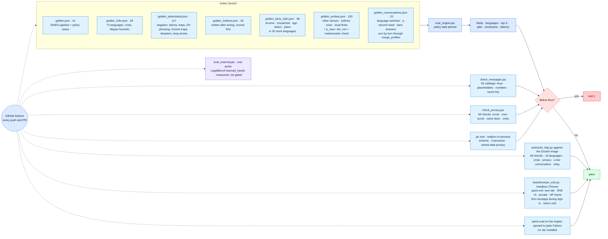

# Evaluation and hard tests

Every suite, what it checks, and the external check on real posts. The README has the current numbers.




```
cd civicmesh && jac run tests/eval_engine.jac
  631 cases + 27 conversations (66 turns) · field accuracy 100% (1410/1410) · 73/73 languages · top-3 100% · exclusion errors 0
  metamorphic 228/228 neutral additions moved no verdict · latency / turn p50 ~1.2 ms · p95 ~2.4 ms

cd civicmesh && jac run tests/check_messages.jac
  50 languages + English source, 105 keys each · PASS

cd civicmesh && jac run tests/check_privacy.jac
  66 checks (34 scrub, 21 keep, 5 same-facts, 6 crisis) · PASS · known misses printed: 0/5 caught

cd civicmesh && jac run tests/check_policy.jac
  100 checks: SNAP FY2026 → FY2027 on 2026-10-01, state gross limits, net test, state minimums, unearned income, P.L. 119-21 dates and notes · PASS

cd civicmesh && rm -rf .jac/data && jac test tests/test_privacy_graph.jac   # + test_schema, persona_* (8 tests); clean store, see docs/MAINTENANCE.md
  OK

python3 tests/e2e_http.py http://localhost:7860
  71/71 passed · turn latency p50 ~0.4 s

cd civicmesh && jac run tests/check_prior.jac
  9 checks: the client-held profile is range-checked, and flags and the household count must be supported by the person's own words · PASS

python3 tests/browser_e2e.py http://localhost:7860   # headless Chrome
  16 checks · PASS

cd civicmesh && jac run tests/eval_external.jac   # real posts, downloaded on first run
```

| Suite | Cases | Covers |
|---|---|---|
| `golden.json` | 41 | EN/ES full pipeline plus policy cases: refugee and SNAP, Texas childless adult and Medicaid, California expansion, 130% FPL for 4, the Alaska table, SNAP present in the plan |
| `golden_i18n.json` | 93 | Language ID and routing in 73 languages including Cantonese, Pashto, Sorani and Kurmanji, Tigrinya, Romanian, both BCS scripts, Yoruba, Igbo, Hausa, Cebuano, Samoan, Tongan, Yiddish and Quechua. Also crisis and violence phrasing, an Estonian sentence that must stay unidentified, and the Mayan heuristic |
| `golden_adversarial.json` | 157 | Cross-category traps ("no food at home", "debt collectors about hospital bills"), negation, possession, idioms ("dying of hunger"), code-switching, romanized scripts, no-signal input, everyday domestic-violence phrasing in five languages with false-alarm guards ("打我电话" is "call me"; a pounding heart is not violence). Income traps: rent paid, a date, a zip code, "3 years"; amounts without a dollar sign; ages in words; warning signs in ten more languages; a home lost to a fire, flood or storm; 500+ character stories with one passing keyword (English and Spanish), with the same story plus a real request as the control |
| `golden_holdout.json` | 40 | Written *after* tuning on the adversarial set, then scored before any fix |
| `golden_facts_i18n.json` | 48 | Income, household, age, status and location stated in Chinese, Cantonese, Korean, Vietnamese, Russian, Ukrainian, Arabic, Persian, Hindi, Bengali, Punjabi, Gujarati, Telugu, Tamil, Japanese, Tagalog, Haitian Creole, French, Portuguese and Polish, with traps: rent that isn't income, "not a citizen", an abusive partner outside the household, a child's age, other-script digits, 万 multipliers, Chinese numerals (两千五百), hourly pay with stated hours, Taglish and Hinglish counts |
| `golden_probes.json` | 100 | Words in their other senses, each paired with the true positive it must not break: "social security" as a number, card or office; a college senior; retired from the army at 42; the Salvation Army; serving tables; a car parked on the street; adult children who moved out; a child-care job; substance-abuse treatment; "my back hurts me"; an injury at work; negated facts in English and Spanish; a temporary visa stated by the speaker vs. a friend's. Also indirect crisis wording (988 / Hotline warning signs) with benign counterparts, the scorer's situation targets under negation, household counts ("there are 3 people"), local HUD limits, and Danger Assessment phrasing (passive voice, hands around the neck, a knife pulled, threats to kill) with benign twins ("hit by a truck", "choked on a fishbone", "kill the deal"). `p_max` / `tier_not` fail the run if a wrong flag moves a verdict |
| `golden_conversations.json` | 22 (52 turns) | Multi-turn: Chinese → Portuguese → English with facts carried; violence disclosed in one language, shelter asked in another; a second need; bare answers ("3", "2000", "两千五", "15 an hour", "nada"); an answer to a different question; a corrected income; a corrected household ("we are 4 not 5"); flags taken back ("I have a place to sleep", "no kids", "not a veteran", a "yes" to the shelter question) while a crisis flag stays; a mother's age after the speaker's; "also" keeping the first need. The eval passes each earlier turn through `sanitize_prior`, as the server does |
| `golden_crisis.json` | 141 | The second outside reviewer's self-harm, violence, child-abuse, trafficking, sexual-assault and emergency messages, with figurative traps ("this rent is killing me"). Fails on a single miss. The parser was fixed toward these messages, so they are a development set, not a measure of recall on unseen messages |


## External check: real people's words

Every suite above was written by the engine's author, so 100% on them only proves the engine handles what the author thought of. `tests/eval_external.jac` runs the router on [LegalBench](https://hazyresearch.stanford.edu/legalbench/)'s `learned_hands` tasks. These are real posts from people describing their own problems on r/legaladvice, labeled Yes/No per issue by law students and lawyers in the [Learned Hands](https://www.justicebench.org/dataset/learned-hands) project (Stanford Legal Design Lab and Suffolk LIT Lab, CC BY-NC-SA 4.0). The data is downloaded at run time and never committed.

To avoid tuning to the test, each task's posts are split by index. Misses were read only on the dev half. The held-out half was never looked at, only scored, and its number is the one to quote.

| Task (engine output checked) | Held-out recall, first run | Held-out recall now (95% CI) | False positives (held-out, now) |
|---|---|---|---|
| Domestic violence (the dv flag or the concern layer, which pin the hotline) | 38.6% (17/44) | **68.2%** (30/44; 53–80%) | 2.3% (1/43) |
| Housing (routed to housing) | 77.0% | 81.3% (911/1,120; 79–84%) | 12.0% |
| Health (routed to healthcare) | 78.9% | 77.2% (44/57; 65–86%) | 10.7% |
| Immigration (an immigration status read) | 67.6% (23/34) | **79.4%** (27/34; 63–90%) | 3.0% |

The domestic-violence number is the important one. A self-written suite at 100% had hidden that most real descriptions of abuse ("he kicked me in the stomach", "a restraining order", "my attacker", "terrified for her life") never raised the flag. The latest round added, as patterns, the [Danger Assessment](https://www.dangerassessment.org/)'s strongest predictors of partner homicide (strangulation, threats to kill, weapons, forced sex, escalating violence) and the [Hotline](https://www.thehotline.org/identify-abuse/domestic-abuse-warning-signs/)'s warning signs, each with a benign probe. That moved the dev half from 74% to 81% and the held-out half by one post (63.6% → 65.9%), well inside the interval: word patterns are near their ceiling on long narratives, and it still misses about a third. So the design no longer depends on detection to show a number. **911, 988 and the Domestic Violence Hotline (call 1-800-799-7233 or text START to 88788) are shown under the chat box on every screen**, and detection only decides whether the hotline is also pinned to the top of the plan. These are long Reddit narratives, which are harder than the short requests the router is built for, and some labels are noisy (6 of the 11 dev-half misses are about a speeding ticket, unpaid wages, a psychiatric hold or sleeplessness). This suite is a measurement, not a gate: CI prints it on every run. Regression cases from real intake conversations with a legal-aid or 211 partner would be the next step up.

**Honest numbers:**
- First runs scored **74%** category accuracy on the adversarial suite and **78%** of checks on the held-out batch.
- The held-out misses included two safety gaps, fixed first: "I don't want to live anymore" raised no crisis flag, and two domestic-violence phrasings were missed.
- The first run of the expanded language suite caught two false detections: Estonian taken for German because of "ü", and Romanian taken for Marshallese because "m̧" contains a plain "m". Both were fixed.
- The first run of the facts suite scored 166/168. Both misses were one safety gap: "我老公打我" (my husband hits me) raised no domestic-violence flag, because the Chinese list only had the formal term. Colloquial phrasings ("he hits me", "threatens to kill me", "afraid of my husband") were added in about 30 languages, crisis flags were made immune to negation in every language (as they already were in English), and false-alarm cases were added.
- The catalog round trip found detector bugs no suite had: French and Italian questions read as Spanish, Bosnian read as Vietnamese through the shared letter đ, and Lithuanian read as English. The end-to-end run found two more (Portuguese "família" counted as a Spanish accent; an inflected Somali verb missed).
- The first probing pass (42 cases written to break the flag lexicon) failed 22 of 65 checks, and the first external run put domestic-violence recall on real posts at 39%. Both are described above. They are the clearest evidence that a self-written suite at 100% measures the author's imagination.
- Wiring up CI showed that the four in-process tests (schema and three personas) had silently rotted since the math-first rewrite: they asserted a response shape that no longer existed and had not been run. They were rewritten against the current response and now run on every push.
- Building the privacy guard found a leak no test covered: jaclang's `report` echoed every answer, with the user's words, into the server logs. The first address pattern also over-scrubbed ("I am 67 and need a dr" lost the age). Over-scrub cases now guard against that.
- All suites were written by the engine's author. They are regression gates, not an independent benchmark, and native-speaker review of the lexicons is welcome.

**End to end:** `tests/e2e_http.py` drives a running server the way the chat client does, with no model key needed:
- the exact Chinese message from a live report ("我今天在哪里可以得到食物？我没有工作。")
- facts stated in Chinese that must not be asked again
- an English chip payload and a quick reply sent with the case language pinned
- Chinese self-harm and domestic-violence messages
- 14 more languages that must come back composed natively
- a language without a catalog, the interpreter tier, English and Spanish regressions
- hostile input: 6,000 characters, `<script>`, SQL-shaped text, emoji only, a prompt injection planting a phone number
- privacy: the words typed (an SSN, a phone number) reach neither the stored need nor the stored self-critique, an unroutable message is not sent to a model, a crisis turn requests no narration and `NarrateWalker` refuses it, draft catalogs (Spanish included) carry the English original and English crisis lines, and **Delete my data** empties the graph without touching another visitor

Result: **69/69** locally. It also covers the live conversation that got stuck (household 3, the disability "yes" applied, a visitor with no seeded catalog), a narrator that refuses unsigned facts, indirect crisis cues pinning 988 and the DV hotline, and unrouted messages getting a question instead of guessed programs. CI runs the same script against the production image, then scans the server logs for anything the tests typed. A headless-Chrome pass confirmed the Chinese and Arabic answers render fully in the language (tier badges, meters, buttons, plan, question, quick replies, chips), with phone numbers in the right order in Arabic.

| Measure | Before (LLM per step) | Now |
|---|---|---|
| Chat turn on the live Space | 60+ s | answer on screen about 1 s after the click; server time 60–200 ms |
| Tamil / Hindi / Chinese turn | 33 s, then an English-only reply | routed without a model: 0.25–0.5 s locally; summary in the user's language afterwards (2.5–4.2 s measured live for ta, hi, zh, vi) |
| LLM calls on the critical path | 7–15 sequential | 0 (a routing model only if an operator opts in) |
| Follow-up question and chips in Chinese | English, then translated 18 s after the answer (live logs) | in the same response as the answer, from the catalog |

---
